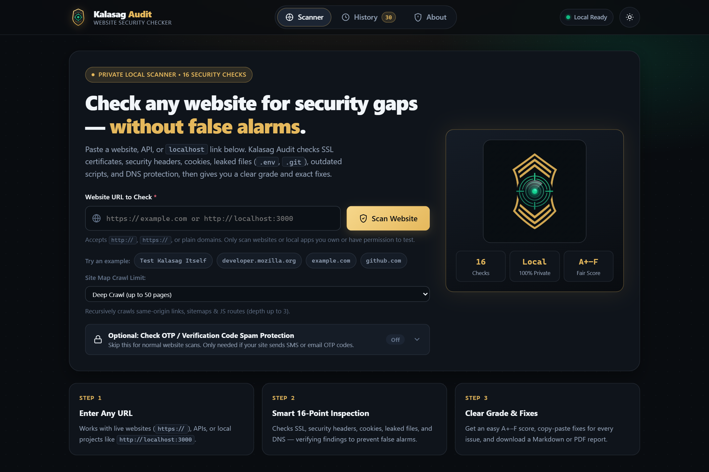
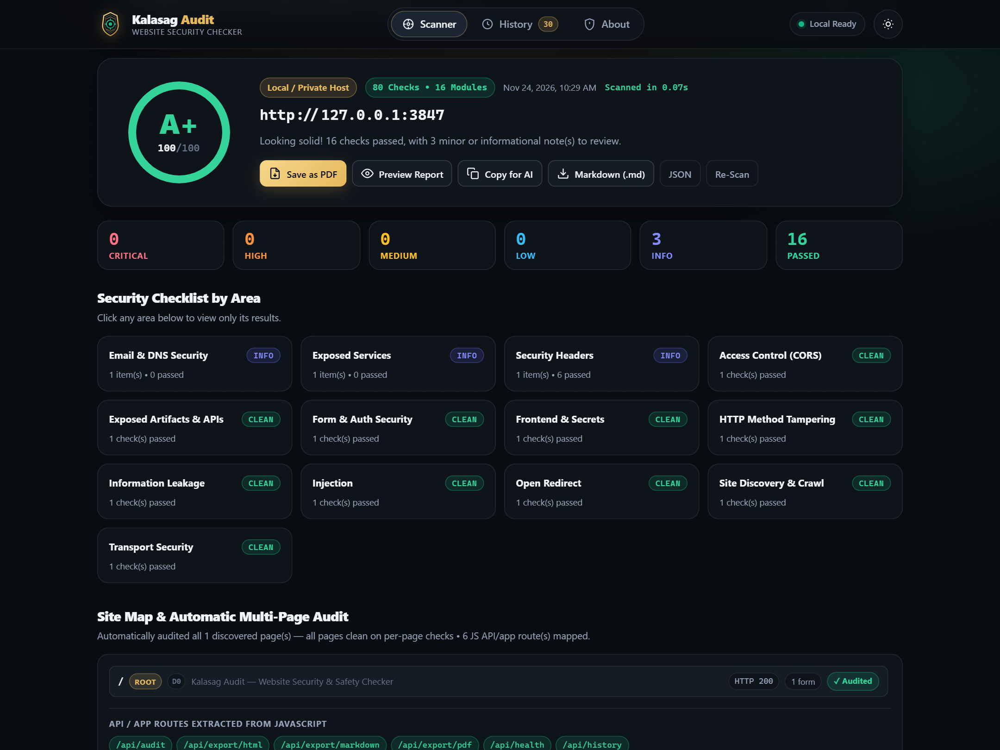
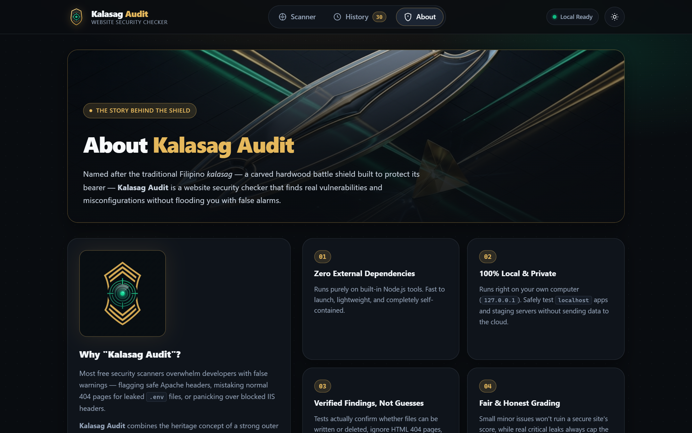

<div align="center">
  
  <h1>Kalasag Audit</h1>
  <p><strong>Zero-Dependency, Multi-Page Web Security &amp; Posture Auditor (Web UI · CLI · Vercel Serverless)</strong></p>
  <p><strong>Live Demo:</strong> <a href="https://kalasag-audit.vercel.app">https://kalasag-audit.vercel.app</a></p>

  <p>
    
    
    
    
    
  </p>
</div>

Named after the traditional Filipino *kalasag* battle shield, **Kalasag Audit** is a lightweight, spec-driven web security auditor engineered to uncover real vulnerabilities and configuration gaps **without flooding developers with false alarms**.

Built purely on the Node.js standard library (`node:http`, `node:tls`, `node:net`, `node:dns/promises`, `node:crypto`, native `fetch`), it runs both as a **full-power local workstation tool (Web UI + CLI)** and as a **hardened Vercel Serverless deployment**.

> **Scope & Ethical Use:** Run Kalasag Audit only against websites, APIs, or local applications you own or have explicit permission to test.

---

## Screenshots

### Scanner Command Deck


### Live Audit Dashboard, Fair A+–F Scoring & Automatic Site Map


### Editorial About & Methodology View


---

## Key Highlights

- **Zero Runtime Dependencies:** Pure Node.js ESM backend and vanilla HTML/CSS/JS frontend — zero npm bloat, zero third-party CDNs, zero supply-chain CVEs.
- **Recursive Multi-Page Crawler & JS Route Extractor:** Automatically crawls same-origin pages across Depth 1 → 3 (HTML links, `robots.txt`, nested `sitemap.xml`), harvests `/api/...` routes from JavaScript bundles (Katana-style), avoids pagination loops with structural deduplication, and audits every discovered page in one shot.
- **Anti-False-Alarm Engineering:** Follows real specs — W3C CSP Level 3 directive fallback, RFC 6797 quoted HSTS, RFC 7489 DMARC (`p=` vs `sp=`), RFC 8659 parent-climbing CAA, soft-404 HTML rejection, baseline-compared error-based SQLi/XSS checks, and canary-verified `PUT`/`DELETE` checks.
- **Dual-Mode Local & Cloud Security Architecture:** One modular API layer (`src/apiHandlers.js`) powers both `node:http` locally and Vercel Serverless Functions (`api/`), automatically switching safety guardrails when deployed publicly.
- **Executive & Developer Exports:**
  - **Save as PDF / Preview Report:** Clean A4 editorial security report (direct headless Chrome/Edge binary `.pdf` locally; instant stateless print-ready A4 view on Vercel).
  - **AI-Ready Markdown (`.md` & Copy for AI):** Structured remediation report with exact evidence, fixes, and "do not regress" passed controls ready to paste straight into any AI coding assistant.
  - **JSON Export** and **Dark / Light Theme** support.
- **Self-Hardened (`100/100 [A+]`):** Strict CSP (`script-src 'self'; style-src 'self'`), zero `innerHTML` sinks, HSTS, `X-Frame-Options: DENY`, `nosniff`, COOP, path-traversal protection, and 512 KB bounded response reads.

---

## Dual-Mode Architecture (Local vs. Vercel Cloud)

| Capability | Local Mode (`npm run ui` / CLI) | Public Cloud Mode (Vercel) |
| --- | --- | --- |
| **Target Scope** | Public websites, `localhost`, private LANs & staging | Public websites only (DNS-resolved **SSRF blocking** + redirect hop re-validation) |
| **Multi-Page Site Crawl** | Up to **100 pages** (Depth 3) + 12 JS bundles | Up to **100 pages** (Depth 3) + 12 JS bundles |
| **14 Core Security Modules** | Active | Active |
| **DB/Admin Port Probe (#15)** | Active (10 ports; skip with `--no-services`) | Auto-disabled (`read-only`) |
| **GET SQLi / XSS Check (#16)** | Active across root + crawled pages (`--no-injection` to skip) | Auto-disabled (`read-only`) |
| **Active `PUT`/`DELETE` & OTP Probe** | Active / Opt-in (hard-capped 2–6 sends) | Auto-disabled (`403`) |
| **Abuse Protection** | Localhost-bound (`127.0.0.1`) | Per-IP sliding-window rate limiter (`429` + `Retry-After`) + same-origin check |
| **Scan History** | Saved locally in `.kalasag-history.json` | Stored privately per visitor in browser `localStorage` |
| **PDF Export** | Direct binary `.pdf` via local Chrome/Edge | Stateless print-ready A4 report (`autoPrint`) |

---

## All 16 Detection Modules

| # | Module | What It Checks |
| --- | --- | --- |
| 1 | **Transport Security** | HTTP → HTTPS redirection with automatic local/private dev host awareness |
| 2 | **TLS / SSL Cryptography** | Cert expiry & issuer, deprecated TLS 1.0/1.1, weak ciphers, trust/hostname/self-signed validation, weak RSA keys (<2048-bit) |
| 3 | **Security Headers** | HSTS (incl. quoted `max-age`), W3C CSP L3 (`script-src` vs `style-src`, nonces/hashes, `default-src` fallback), `X-Frame-Options`, `nosniff`, `Referrer-Policy`, `Permissions-Policy`, `COOP`, duplicate headers |
| 4 | **Server Fingerprinting** | Granular version numbers in `Server`, `X-Powered-By`, `X-AspNet-Version`, `X-Runtime`, `X-Generator` |
| 5 | **Cookie Security** | `Secure`, `HttpOnly`, `SameSite`, `__Host-`/`__Secure-` prefix rules; skips deletion & analytics cookies |
| 6 | **HTTP Methods** | `OPTIONS`, active `TRACE` (XST), and (locally) canary-verified `PUT`/`DELETE` |
| 7 | **Access Control (CORS)** | Arbitrary reflected `Origin` with credentials; wildcard `*` advisory |
| 8 | **Exposed Files & APIs** | 25 probes: `.git`, `.env` (+ `.local`/`.production`/`.bak`), `.sql` dumps, source backups, **phpMyAdmin** & **Adminer**, `phpinfo.php`, `/server-status`, Spring `/actuator/health`, `/swagger.json`, `/graphql` introspection, directory listing, `security.txt` |
| 9 | **Frontend & Supply Chain** | Active/passive mixed content, Subresource Integrity (SRI), JS secret scan, outdated JS libraries (`jQuery`, `Bootstrap`, EOL `AngularJS 1.x` via filenames & `/*!` banners) |
| 10 | **Site Discovery & Crawl** | Recursive multi-depth BFS same-origin crawl, `robots.txt` sensitive hints, `sitemap.xml`, JS bundle API route extraction & subpage header/cookie drift |
| 11 | **Form & Auth Hygiene** | Explicit `POST` forms missing anti-CSRF tokens, plain-HTTP password inputs & HTTPS → HTTP form action downgrades across all crawled pages |
| 12 | **Open Redirects** | 13 probes (11 common redirect params + `//` bypass) with a non-resolving `.example` canary |
| 13 | **Subdomain Takeover** | Dangling CNAME records across 11 cloud/hosting providers verified against unclaimed fingerprints |
| 14 | **DNS & Email Security** | Organizational-domain SPF & DMARC (`p=` vs `sp=`), parent-climbing CAA, MX & common DKIM selectors |
| 15 | **Exposed Services *(Local)*** | Active TCP probe for MySQL, PostgreSQL, MongoDB, Redis, Elasticsearch, MSSQL, Memcached, CouchDB, RDP & port `9000` |
| 16 | **Injection SQLi / XSS *(Local)*** | Baseline-compared error-based SQL injection and reflected XSS across GET parameters on the target URL & crawled subpages |
| + | **OTP Rate Limiting *(Local Opt-In)*** | Hard-bounded (2–6 spaced sends) self-test verifying `429` / cooldown throttling on your own OTP API |

---

## Quick Start

### 1. Clone & Launch the Local Web UI
```bash
git clone https://github.com/Shiidoooo/Kalasag-Audit.git
cd Kalasag-Audit
npm run ui
# or automatically open your browser:
node bin/kalasag-ui.js --open
```
Open **`http://127.0.0.1:3847`** in your browser (requires Node.js 18+; no `npm install` needed).

### 2. Run from the CLI
```bash
node bin/kalasag.js https://example.com
node bin/kalasag.js localhost                        # bare local hosts default to http://
node bin/kalasag.js 127.0.0.1:8080/app/ --max-pages 100
node bin/kalasag.js 192.168.1.50 --no-services --no-injection
node bin/kalasag.js https://api.example.com --config ./kalasag.config.json --yes
```

**CLI Flags:**
- `--max-pages <n>` — set recursive crawl limit (1–100, default 50 locally).
- `--no-services` — skip the active database/admin TCP port probe.
- `--no-injection` — skip active GET-parameter SQLi/XSS checks.
- `--config <path>` / `--otp-config <path>` — path to an opt-in OTP rate-limit config (`kalasag.config.json`).
- `--yes` / `-y` — skip interactive prompt for the active OTP probe in CI/non-TTY runs.

### 3. Run the Automated Test Suite (47 Tests)
```bash
npm test
```

---

## Deploying to Vercel

Kalasag Audit ships pre-configured for zero-config Vercel deployment (`vercel.json` + `api/`):

1. Import this repository at **[vercel.com/new](https://vercel.com/new)** (or run `npx vercel --prod` locally).
2. Keep **Framework Preset: Other** and **Node.js 20.x / 22.x** — no build command or environment variables are required.
3. On Vercel (`VERCEL=1`), Public Cloud Mode activates automatically with SSRF blocking, rate limiting, HSTS/CSP headers, and read-only scanning.

### Optional Environment Variables
- `KALASAG_PUBLIC_MODE=true` — explicitly enable Public Cloud Mode when hosting outside Vercel (Docker, Render, Fly.io, etc.).
- `KALASAG_CHROME_PATH` — optional Chrome/Edge binary path for direct local PDF rendering.

### Post-Deploy Smoke Check & Rollback
1. Verify `GET https://<your-domain>/api/health` returns `"mode": "public"`.
2. Verify scanning `https://example.com` succeeds, while scanning `http://169.254.169.254/` returns `422 SSRF_BLOCKED`.
3. Roll back anytime via Vercel **Deployments → Promote to Production** (or `vercel rollback`).

---

## API Endpoints

| Method | Path | Purpose |
| --- | --- | --- |
| `GET` | `/api/health` | Service health check & runtime mode (`local` vs `public`) |
| `POST` | `/api/audit` | Run a multi-page security audit (`{ url, maxPages?, otpTest?, confirmOtp? }`) |
| `POST` | `/api/export/markdown` | Export an AI-ready Markdown remediation report (`.md`) |
| `POST` | `/api/export/html` | Stateless printable A4 HTML report preview (supports `autoPrint=1`) |
| `POST` | `/api/export/pdf` | Direct binary A4 PDF download (local mode with Chrome/Edge) |
| `GET` / `DELETE` | `/api/history` | Local-only saved scan history (`.kalasag-history.json`) |
